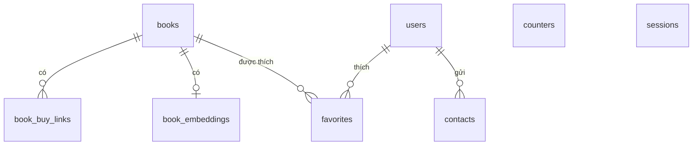

# 03 — Cơ sở dữ liệu (MySQL)

- **MySQL 8.4 LTS** (không dùng `mysql:8.0`: đã hết hỗ trợ từ 30/4/2026, không còn vá bảo mật), engine InnoDB.
- **ORM:** Sequelize 6 (`^6.37.8`, không dùng bản v7 alpha) + driver `mysql2`; migration bằng `sequelize-cli`. Nếu giảng viên yêu cầu `mysql2` thuần hoặc ORM khác, sửa ở `AGENTS.md` mục 3 và file này **trước khi code**.
- Chạy trong Docker, xem `12-docker-and-deployment.md`.

## 1. Quy ước chung

| Hạng mục | Quy ước |
|---|---|
| Bảng/cột | Bảng số nhiều `snake_case` (`books`), cột `snake_case` (`product_name`). Trong code dùng camelCase (`productName`) nhờ `underscored: true` của Sequelize |
| Ký tự | `utf8mb4` + collation `utf8mb4_unicode_ci` (đặt ở server `--character-set-server`/`--collation-server` và ở kết nối) — bắt buộc để tiếng Việt có dấu đúng |
| Khóa chính | `id INT UNSIGNED AUTO_INCREMENT`. URL API dùng `id` này, **không** dùng `productId` |
| Thời gian | `DATETIME`, lưu UTC (`timezone: '+00:00'`), client hiển thị giờ `Asia/Ho_Chi_Minh`. Cột `create_date`, `update_date` (đề bài: CreateDate/UpdateDate); trong Sequelize: `createdAt: 'createDate'`, `updatedAt: 'updateDate'` |
| Tiền | Số nguyên VND, `INT UNSIGNED` (không dùng `DECIMAL` vì Sequelize trả về chuỗi) |
| Khóa ngoại | Luôn khai báo `FOREIGN KEY` với `ON DELETE` rõ ràng (CASCADE hoặc SET NULL) |
| Thay đổi schema | **Chỉ qua migration** (`sequelize-cli`). Mỗi bảng/thay đổi một file, đặt tên `YYYYMMDDHHmmss-<a|b|c>-<mô-tả>.js` (tiền tố người phụ trách để không đụng nhau). Không dùng `sync({ force | alter })` ngoài thử nghiệm cá nhân |
| Truy vấn | Luôn tham số hóa (toán tử của Sequelize, `replacements`/`bind`); **không** nối chuỗi người dùng vào SQL, không đưa dữ liệu người dùng vào `sequelize.literal` |
| Model | Mỗi file trong `models/` export `init` và `associate(models)`; `models/index.js` (của A) tự nạp tất cả file và gọi `associate` — người khác thêm model không cần sửa `index.js` |

## 2. Sơ đồ quan hệ



Bảng: `books`, `book_buy_links`, `book_embeddings`, `counters` (mục này); `users`, `favorites`, `contacts`, `sessions` (xem `11-user-area.md` mục 3); `SequelizeMeta` (do `sequelize-cli` quản lý).

## 3. Bảng `books`

Ánh xạ trường của đề bài sang cột:

| Đề bài | Cột | Attribute (code) | Kiểu MySQL | Quy tắc |
|---|---|---|---|---|
| ProductID | `product_id` | `productId` | `VARCHAR(20) NOT NULL UNIQUE` | Dạng `BK00001`; tự sinh nếu để trống; **không đổi sau khi tạo** (service bỏ trường này khi cập nhật) |
| ProductName | `product_name` | `productName` | `VARCHAR(200) NOT NULL` | 2–200 ký tự, trim |
| PathImage | `path_image` | `pathImage` | `VARCHAR(500) NOT NULL DEFAULT '/images/no-cover.png'` | Đường dẫn nội bộ `/uploads/books/<tên-file>` **hoặc** URL `https://` của nguồn ngoài (xem mục 11) |
| ProductType | `product_type` | `productType` | `VARCHAR(100) NOT NULL`, **INDEX** | Thể loại |
| Description | `description` | `description` | `TEXT NULL` | ≤ 5000 ký tự (kiểm tra ở app) |
| CreateDate | `create_date` | `createDate` | `DATETIME NOT NULL` | Hệ thống gán, **INDEX** |
| UpdateDate | `update_date` | `updateDate` | `DATETIME NOT NULL` | Tự cập nhật |

> Các trường `Quantity`, `Unit`, `Price` của đề bài **không có trong schema** vì hệ thống không bán sách. Nếu giảng viên yêu cầu giữ, thêm lại bằng một migration mới.

Cột mở rộng (không phá yêu cầu đề bài, phục vụ tìm kiếm & đề xuất):

| Cột | Kiểu | Ghi chú |
|---|---|---|
| `id` | `INT UNSIGNED` PK | |
| `author` | `VARCHAR(150) NULL` | Tác giả |
| `publisher` | `VARCHAR(150) NULL` | Nhà xuất bản |
| `publish_year` | `SMALLINT UNSIGNED NULL` | |
| `isbn` | `VARCHAR(20) NULL` | Không bắt buộc duy nhất |
| `tags` | `JSON NULL` | Mảng 3–6 từ khóa chủ đề; `NULL` được hiểu là `[]`. Dùng cho tìm kiếm, "sách tương tự" và văn bản tạo embedding |
| `search_text` | `TEXT NULL` | Cột dẫn xuất: `normalizeText(product_name + author + product_type + tags + description)` — bỏ dấu, chữ thường; phục vụ tìm không dấu ở provider fallback. Model dùng `defaultScope` để **không** tải cột này ở mọi truy vấn |

`normalizeText` phải xử lý cả `đ → d` (collation không tự làm được). Cập nhật lại `search_text` mỗi khi một trong các trường nguồn đổi.

## 4. Bảng `book_buy_links` (1–n)

Link mua sách ở trang bên ngoài.

| Cột | Kiểu | Ghi chú |
|---|---|---|
| `id` | `INT UNSIGNED` PK | |
| `book_id` | `INT UNSIGNED NOT NULL` | FK → `books.id`, `ON DELETE CASCADE`, INDEX |
| `store` | `VARCHAR(50) NOT NULL` | Tên cửa hàng |
| `url` | `VARCHAR(500) NOT NULL` | Chỉ `http`/`https` (chặn `javascript:`, `data:`) |
| `position` | `TINYINT UNSIGNED NOT NULL DEFAULT 0` | Thứ tự hiển thị |

Tối đa 5 link/sách (kiểm tra ở schema zod). Khi tải chi tiết sách thì `include` bảng này, sắp theo `position`; **không** include trong API danh sách (tránh nhân dòng và đếm sai tổng).

## 5. Bảng `book_embeddings` (1–1)

| Cột | Kiểu | Ghi chú |
|---|---|---|
| `book_id` | `INT UNSIGNED` PK | FK → `books.id`, `ON DELETE CASCADE` |
| `embedding` | `JSON NOT NULL` | Mảng số (vector) |
| `text_hash` | `CHAR(64) NOT NULL` | Hash của `embeddingText`; chỉ tạo lại khi hash đổi |
| `model` | `VARCHAR(100) NOT NULL` | Tên model embedding đã dùng; đổi `AI_EMBED_MODEL` thì tạo lại |
| `update_date` | `DATETIME NOT NULL` | |

Tách bảng riêng để `books` nhẹ, vector không bao giờ lọt vào API sách, và đổi model chỉ cần tạo lại bảng này. Khi server khởi động, nạp toàn bộ vào chỉ mục trong bộ nhớ (xem `06-ai-integration.md` mục 4).

## 6. Bảng `counters` và sinh `productId`

| Cột | Kiểu |
|---|---|
| `name` | `VARCHAR(30)` PK |
| `seq` | `INT UNSIGNED NOT NULL` |

Migration chèn sẵn dòng `('book', 0)`. Sinh mã **nguyên tử** trong cùng một transaction (hàm `LAST_INSERT_ID(expr)` theo kết nối, nên bắt buộc dùng cùng connection/transaction):

```js
// Trong transaction t
await sequelize.query("UPDATE counters SET seq = LAST_INSERT_ID(seq + 1) WHERE name = 'book'", { transaction: t });
const [{ n }] = await sequelize.query('SELECT LAST_INSERT_ID() AS n', { type: QueryTypes.SELECT, transaction: t });
const productId = 'BK' + String(n).padStart(5, '0');
```

- Import mà dòng có sẵn `productId` → dùng giá trị đó; để trống → tự sinh. Nếu mã tự sinh đã tồn tại (do import trước đó) → lấy số kế tiếp.
- Sao chép → luôn sinh `productId` mới.

## 7. Truy vấn quan trọng

| Việc | Cách làm |
|---|---|
| Danh sách phân trang | `findAndCountAll({ where, order, limit, offset })`, không `include` quan hệ 1–n |
| Chi tiết sách | `findByPk` + `include` `buyLinks` |
| Tìm kiếm fallback (DB provider) | Chuẩn hóa chuỗi tìm, tách từ khóa; mỗi từ khóa `search_text LIKE ? ESCAPE '\\'` (AND), tham số hóa, đã `escapeLike` (`%`, `_`, `\`) |
| Thể loại hiện có | `SELECT DISTINCT product_type FROM books ORDER BY product_type` |
| "Được yêu thích nhiều" | `favorites` `GROUP BY book_id ORDER BY COUNT(*) DESC` |
| Sao chép sách | Trong 1 transaction: tạo sách mới (sinh `productId`) + sao chép các dòng `book_buy_links` |
| Xóa sách | Khóa ngoại `ON DELETE CASCADE` tự xóa link mua, embedding, yêu thích; app xóa file ảnh chỉ khi không còn sách nào dùng chung đường dẫn |
| Import / bulk | Chạy trong transaction theo lô; dùng `bulkCreate`/`destroy` với `where id IN (...)`, không lặp từng bản ghi |

## 8. Ảnh bìa

- Lưu file trong `public/uploads/books/` (trong Docker là một **volume** để không mất khi tạo lại container), tên file do hệ thống đặt (hash nội dung, ví dụ `<sha1-16-ký-tự>.<ext>` — cùng một ảnh không bị lưu trùng), **không dùng tên file gốc**.
- Chỉ nhận `jpg/jpeg/png/webp`, ≤ `MAX_IMAGE_MB`.
- Một đường dẫn ảnh có thể được nhiều sách dùng chung (do sao chép) → chỉ xóa file khi **không còn bản ghi nào** tham chiếu (xem F03, F05, F07).

## 9. Thể loại gợi ý (`product_type`)

Văn học · Kinh tế · Kỹ năng sống · Tâm lý · Thiếu nhi · Khoa học · Công nghệ · Lịch sử · Ngoại ngữ · Truyện tranh.
Danh sách thể loại trong ô lọc lấy động từ `GET /api/books/types` (distinct), không hardcode ở client.

## 10. Dữ liệu mẫu (`npm run seed`)

- Nạp bằng **chính chức năng Import** (F09): ≥ 100 cuốn chia thành 3 gói `scripts/seed.data/a/`, `b/`, `c/` (mỗi gói ≥ 35 sách: `books.json` + thư mục `images/`, đúng định dạng gói ZIP của F09; giữ dạng thư mục để xem diff trên Git). `seed.js` gọi `importFromDirectory(dir, { mode: 'overwrite' })` của dịch vụ import (ở Sprint 0 có thể dùng bộ nạp tối giản rồi chuyển sang dịch vụ import khi F09 xong).
- Mỗi sách: tên, tác giả, thể loại chuẩn, **mô tả 3–5 câu** (đây là dữ liệu để AI tìm theo nội dung nên cần đủ chi tiết), 3–6 tags, 0–2 `buyLinks`; ảnh bìa nằm trong `images/` (≤ 200 KB mỗi ảnh để repo nhẹ), hoặc là URL, hoặc để trống (ảnh mặc định). Để vài sách không có ảnh nhằm kiểm thử trường hợp biên.
- **Idempotent:** chế độ `overwrite` theo `product_id`; ảnh đặt tên theo hash nên chạy lại không tạo file trùng.
- Tạo tài khoản admin từ `ADMIN_EMAIL`/`ADMIN_PASSWORD` (nếu chưa có).
- Docker: chạy tự động khi `AUTO_SEED=true` và bảng `books` còn trống.
- Sau seed: nếu `SEARCH_PROVIDER=meili` thì reindex; nếu có `AI_API_KEY` thì tạo embedding ở nền, tuần tự (hoặc chạy `npm run embed`) — chú ý hạn mức miễn phí, xem `06` mục 3A.

## 11. Chuẩn bị dữ liệu sách để nạp bằng Import

Nhóm nạp dữ liệu bằng chức năng **Import** (F09) thay vì thêm từng cuốn bằng form. Mục tiêu: dữ liệu **thật, chính xác** (không để AI tự bịa) và link mua **thật**.

**Nguyên tắc**
1. **Thông tin sự kiện thì dùng được, văn bản sáng tạo thì tự viết:** tên sách, tác giả, ISBN, nhà xuất bản, năm xuất bản, thể loại là thông tin sự kiện. Phần giới thiệu/mô tả, ảnh bìa và đánh giá do nhà xuất bản/nhà sách tạo ra — không sao chép hàng loạt vào hệ thống.
2. **Không để LLM tự sinh nội dung sách hoặc URL** (dễ sai và bịa). LLM chỉ được tóm tắt/viết lại một đoạn văn bản **người dùng đưa vào**, và con người phải đọc kiểm tra.
3. **Không crawl hàng loạt các trang bán sách.** Mỗi trang có `robots.txt` và điều khoản riêng; nhóm tự đọc trước khi tự động hóa bất cứ thứ gì, và **không** viết mã né cơ chế chống bot.

**Quy trình (mỗi người ≥ 35 sách, trải đều thể loại)**
1. Tải **file/gói mẫu** từ chức năng Import (đã có đúng tên cột: `productName`, `author`, `productType`, `publisher`, `publishYear`, `isbn`, `tags`, `description`, `buyLinks`, `pathImage`).
2. Điền dữ liệu: tên, tác giả, ISBN… từ nguồn đáng tin; **mô tả 3–5 câu tự viết bằng lời của mình**; thể loại thuộc danh sách chuẩn; 3–6 tags; link mua dán tay (URL sản phẩm) hoặc link tìm kiếm của nhà sách.
3. **Ảnh bìa:** bỏ file vào thư mục `images/` và ghi `images/ten-file.jpg` ở cột `pathImage`; hoặc dán URL `https://`; hoặc để trống. Ảnh phải có nguồn hợp lệ (tự chụp/được phép sử dụng); không tải hàng loạt ảnh từ trang bán sách.
4. Nén thành ZIP, **Import thử trên web**, đọc báo cáo lỗi/cảnh báo rồi sửa cho tới khi sạch.
5. Khi đạt, đặt vào `scripts/seed.data/<a|b|c>/` (giải nén) để `npm run seed` dùng.
6. *(Tùy chọn)* Hỗ trợ: script `seed:enrich` gọi Google Books API theo ISBN để gợi ý nhà xuất bản/năm/thể loại, ghi **file nháp** cho người duyệt (key miễn phí, ≤ 1 request/giây, có cache; độ phủ sách tiếng Việt không được bảo đảm); script `check:links` kiểm tra link mua còn sống (mỗi link một lần, cách nhau ≥ 1 giây).

`path_image` chấp nhận đường dẫn nội bộ hoặc URL `https://` (validate chỉ `http`/`https`, thêm domain đó vào `img-src` của CSP); việc xóa file chỉ áp dụng cho đường dẫn nội bộ.
